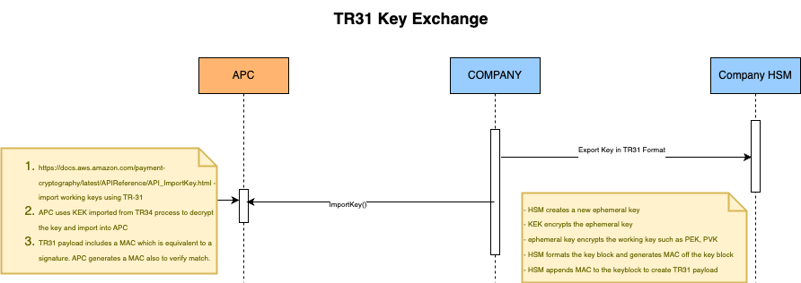

# Key Management (AWS)

### Export symmetric keys using a pre-established key exchange key (TR-31)

<div className="flex justify-center my-8">
  <picture>
    <source srcSet="https://raw.githubusercontent.com/DspreadOrg/docs/main/public/images/webp/tr31.webp 1x" type="image/webp" />
    
  </picture>
</div>

When exchanging multiple keys or supporting key rotation, you typically first exchange an initial key encryption key (KEK) using paper key components or, with AWS Payment Cryptography, using [TR-34](https://docs.aws.amazon.com/payment-cryptography/latest/userguide/keys-export.html#keys-export-tr34). After establishing a KEK, you can use it to transport subsequent keys, including other KEKs. We support this key exchange using ANSI TR-31, which is widely supported by HSM vendors.

1. **Set up your Key Encryption Key (KEK)**

   Make sure you have already exchanged your KEK and have the keyARN (or keyAlias) available.

2. **Create your key on AWS Payment Cryptography**

   Create your key if it doesn't already exist. Alternatively, you can create the key on your other system and use the import command.

3. **Export your key from AWS Payment Cryptography**

   When exporting in TR-31 format, specify the key you want to export and the wrapping key to use.

   **Example – Exporting a key using TR31 key block**

   ```bash
   aws payment-cryptography export-key \
   --key-material='{"Tr31KeyBlock": \
   { "WrappingKeyIdentifier": "arn:aws:payment-cryptography:us-east-2:111122223333:key/ov6icy4ryas4zcza" }}' \
   --export-key-identifier arn:aws:payment-cryptography:us-east-2:111122223333:key/5rplquuwozodpwsp
   ```

   ```json
   {
     "WrappedKey": {
       "KeyCheckValue": "73C263",
       "KeyCheckValueAlgorithm": "ANSI_X9_24",
      "KeyMaterial": "D0140B1AX01E0100KS1C11223344556677880000000B0548F4C9B1B8E5C4A6A01947A22D9E99F3CD01853744A9862B3190CDADB34C5C5CBBCCFF38598929B4BAF2A74C0A92EA",
       "WrappedKeyMaterialFormat": "TR31_KEY_BLOCK"
     }
   }
   ```

    **TR-31 key block - IPEK**

  <details>
  <summary>B0104B1TX00E0100KS18FFFF9876543210E00001DAAFAC4553A494DAB8007284A11521ECDFABA4608A6B982F73CC7D9065D27ECF</summary>

  | Field | Value |
  | --- | --- |
  | KBPK | `0123456789ABCDEFFEDCBA9876543210` |
  | TR-31 version | `B` - TDEA Key Derivation Binding Method |
  | Block length | `0104` |
  | Key usage | `B1` - Initial DUKPT Key (IKEY/IPEK) |
  | Algorithm | `T` - Triple DES |
  | Mode of use | `X` - Key used to derive other key(s) |
  | Key version | `00` |
  | Exportability | `E` - Exportable under a KEK |
  | Optional block | `KS18FFFF9876543210E00001` |
  | KSN | `FFFF9876543210E00001` |
  | KSN padding | The KSN is carried in the `KS` optional block. `KS18` includes the block tag, length, and 10-byte KSN. |
  | Encrypted key | `DAAFAC4553A494DAB8007284A11521ECDFABA4608A6B982F` |
  | TR-31 MAC | `73CC7D9065D27ECF` |
  | Plain key | `6AC292FAA1315B4D858AB3A3D7D5933A` |

  </details>

  <details>
  <summary>D0140B1AX01E0100KS1C11223344556677880000000B0548F4C9B1B8E5C4A6A01947A22D9E99F3CD01853744A9862B3190CDADB34C5C5CBBCCFF38598929B4BAF2A74C0A92EA</summary>

  | Field | Value |
  | --- | --- |
  | KBPK | `0123456789ABCDEFFEDCBA9876543210` |
  | TR-31 version | `D` - AES Key Derivation Binding Method |
  | Block length | `0140` |
  | Key usage | `B1` - Initial DUKPT Key (IKEY/IPEK) |
  | Algorithm | `A` - AES |
  | Mode of use | `X` - Key used to derive other key(s) |
  | Key version | `01` |
  | Optional block | `KS1C11223344556677880000000B` |
  | KSN | `11223344556677880000000B` |
  | KSN padding | The KSN is 12 bytes: `1122334455667788` plus the required `0000000B` padding. `KS1C` is the 28-character optional block length. |
  | Encrypted key | `0548F4C9B1B8E5C4A6A01947A22D9E99F3CD01853744A9862B3190CDADB34C5C5CBBCCFF38598929B4BAF2A74C0A92EA` |
  | Plain key | `0123456789ABCDEFFEDCBA9876543210` |

  </details>


    Use the [TR-31 key block tool](https://kabc.ca/keys/tr31) to generate or parse the key blocks.

4. **Import the key to your system**

   Use your system's import key implementation to import the key.

```java
// import tr31 keyblock generated with AWS cloud HSM
pos.sendTR31Key(tr31KeyBlock);
```

