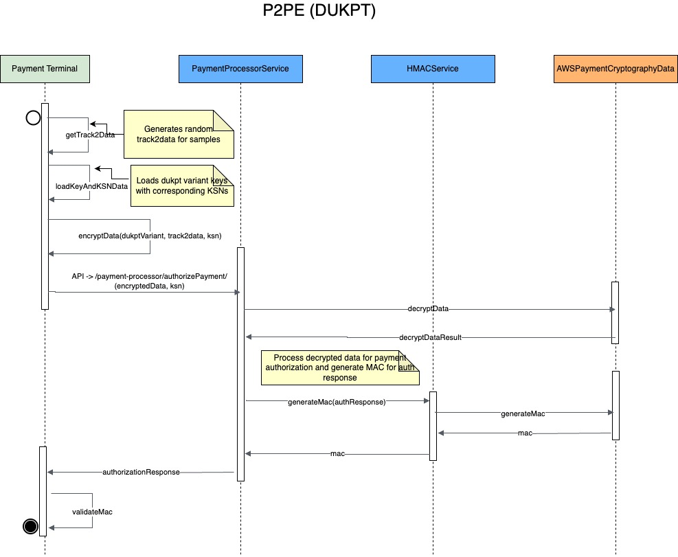

import { Tabs, Tab } from 'nextra/components'

# Payment Gateway (AWS)

Below is an example of how you can use the AWS Payment Cryptography Data Plane API in Java to decrypt data from a POS terminal. In this example, we assume that your POS terminal data was encrypted using a symmetric key (for example, using TDES with CBC mode). You’ll need to adjust the attributes (for example, algorithm, mode, and key length) to match your specific encryption settings.

<div className="flex justify-center my-8">
  <picture>
    <source srcSet="https://raw.githubusercontent.com/DspreadOrg/docs/main/public/images/webp/p2pe.webp 1x" type="image/webp" />
    
  </picture>
</div>

#### Prerequisites

* **AWS Account & Payment Cryptography key**: Ensure you have created or imported a decryption key in AWS Payment Cryptography. The key must have its KeyModesOfUse set to allow decryption.
* **AWS SDK for Java v2**: The Payment Cryptography Data Plane client is available in the AWS SDK for Java v2.
* **POS Terminal Data**: Encrypted POS terminal data (ciphertext) is provided as a hex string by `onDoTradeResult()` and `onRequestOnlineProcess()`.

#### Sample POS Terminal Data

<Tabs items={['ICC', 'NFC/MSR']}>
  <Tab>
  ```text
  2014-08-27 17:52:21.210 qpos-ios-demo[391:60b] alertView.title = Online process requested.
  2014-08-27 17:52:21.211 qpos-ios-demo[391:60b] hideAlertView
  2014-08-27 17:52:21.221 qpos-ios-demo[391:60b] onRequestOnlineProcess = {
      tlv = 5F200220204F08A0000003330101015F24032312319F160F4243544553542031323334353637389F21031752139A031408279F02060000000000019F03060000000000009F34034203009F120A50424F43204445424954C409623061FFFFFFFF5284C10A00000332100300E00003C708A68701E68CB34BDEC00A00000332100300E00003C2820150E84B5D0D2AA9F40A04127284B0BEF5BA7901E0914C3F71C6042C61AE9576615360A8B32507769EA9876CCAE0BD87CE43F729D4509E436C422B556E5E480F1309ACD278EF779911E799D5F8A7C28ABA26654E5A99623E507330446A0C0E8463361E53B6712E080C973EDC44DD09FAB019481DABA6C33933DCE66BB5D2846F3005A5A5A1573199C1FFFA483396D1EE8E5918BD13F761011186C58CF5F2E3A45B4C35508DFD1D28C27207C6D0D6FBFADF9038E97B51B6422F56CFE024B2F284572B2C7DCD7E107D5A1550481A1ADB277F8CA37753E8EFF7980DA392EFCF9D2473F7D37E84B608158FA87FB140701FA09CD2FCC2329CF5A8B92D70FD15010BAF751BC4A3C6FD6DBB3C7C90BB5286AFEC923FAE96C09A4FDB65256FE5D8606132B12A4853B609FB80C8E9172C01F7A152E715A5A75D5305165EDA939E4C51313A176691F55B35207C8857221793AB7C045E48;
  }
  ```

  As we can see from the decoded table:

  | Tag | Tag Name | Value |
  | --- | --- | --- |
  | 5F20 | Cardholder Name | |
  | 4F | AID | A000000333010101 |
  | 5F24 | App Expiration Date | 231231 |
  | 9F16 | Merchant ID | B C T E S T 1 2 3 4 5 6 7 8 |
  | 9F21 | Transaction Time | 175213 |
  | … | … | … |
  | C4 | Masked PAN | 623061FFFFFFFF5284 |
  | C1 | KSN (PIN) | 00000332100300E00003 |
  | C7 | PINBLOCK | A68701E68CB34BDE |
  | C0 | KSN Online Msg | 00000332100300E00003 |
  | C2 | Online Message | E84B5D0D2AA9F40A2EFC… |

  Inside the table, there are:

  1. Some EMV tags (5F20, 4F, 5F24, …) with plaintext values.
  2. Some proprietary tags starting with `0xC`, in this case C4, C1, C7, C0, and C2.
  </Tab>
  <Tab>
  ```text
  onDoTradeResult (NFC/MSR):
  Encrypted Track 1: 22FB2E931F3EFAFC8C3899AB779F3719E75D392365DB748EEA789560EEB7714D84AB7FFA5B2E162C9BD566D03DCD240FC9D316CAC4015B782294365F9062CA0A
  Encrypted Track 2: 153CEE49576C0B709515946D991CB48368FEA0375837ECA6
  Track KSN: 00000332100300E00002
  Encrypted PIN Block: 377D28B8C7EF080A
  PIN KSN: 00000332100300E000C6
  ```
  </Tab>
</Tabs>

#### Example Code

``` java
import software.amazon.awssdk.services.paymentcryptographydata.PaymentCryptographyDataClient;
import software.amazon.awssdk.services.paymentcryptographydata.model.DecryptDataRequest;
import software.amazon.awssdk.services.paymentcryptographydata.model.DecryptDataResponse;
import software.amazon.awssdk.services.paymentcryptographydata.model.EncryptionDecryptionAttributes;

public class DecryptPosTerminalDukptData {

    public static void main(String[] args) {
        // --- Test Data from a real POS terminal ---
        // Encrypted Track 2 data (hex string, 3DES CBC mode per ANSI X9.24-2009 request)
        String encryptedTrack2 = "153CEE49576C0B709515946D991CB48368FEA0375837ECA6";
        // Track KSN used for DUKPT derivation for track data
        String trackKsn = "00000332100300E00002";

        // Encrypted PIN block data (hex string)
        String encryptedPinBlock = "377D28B8C7EF080A";
        // PIN KSN used for DUKPT derivation for PIN decryption
        String pinKsn = "00000332100300E000C6";

        // Replace these with your actual key ARNs from AWS Payment Cryptography.
        String trackKeyIdentifier = "arn:aws:payment-cryptography:us-east-2:111122223333:key/track-key-id";
        String pinKeyIdentifier = "arn:aws:payment-cryptography:us-east-2:111122223333:key/pin-key-id";
        String onlineMessageKeyIdentifier = "arn:aws:payment-cryptography:us-east-2:111122223333:key/online-message-key-id";

        // C2 value from the ICC TLV (excluding the C2 tag and its length)
        String encryptedIccOnlineMessage = "E84B5D0D2AA9F40A04127284B0BEF5BA7901E0914C3F71C6042C61AE9576615360A8B32507769EA9876CCAE0BD87CE43F729D4509E436C422B556E5E480F1309ACD278EF779911E799D5F8A7C28ABA26654E5A99623E507330446A0C0E8463361E53B6712E080C973EDC44DD09FAB019481DABA6C33933DCE66BB5D2846F3005A5A5A1573199C1FFFA483396D1EE8E5918BD13F761011186C58CF5F2E3A45B4C35508DFD1D28C27207C6D0D6FBFADF9038E97B51B6422F56CFE024B2F284572B2C7DCD7E107D5A1550481A1ADB277F8CA37753E8EFF7980DA392EFCF9D2473F7D37E84B608158FA87FB140701FA09CD2FCC2329CF5A8B92D70FD15010BAF751BC4A3C6FD6DBB3C7C90BB5286AFEC923FAE96C09A4FDB65256FE5D8606132B12A4853B609FB80C8E9172C01F7A152E715A5A75D5305165EDA939E4C51313A176691F55B35207C8857221793AB7C045E48";
        // C0 value from the ICC TLV
        String onlineMessageKsn = "00000332100300E00003";

        try (PaymentCryptographyDataClient client = PaymentCryptographyDataClient.create()) {

            // ---------------------------------------
            // Example 1: Decrypt Track 2 Data using DUKPT
            // ---------------------------------------
            // Build decryption attributes for track data using Dukpt.
            EncryptionDecryptionAttributes trackDecryptionAttr =
                    EncryptionDecryptionAttributes.builder()
                            .dukpt(b -> b.keySerialNumber(trackKsn))
                            .build();

            DecryptDataRequest trackRequest = DecryptDataRequest.builder()
                    .keyIdentifier(trackKeyIdentifier)
                    .cipherText(encryptedTrack2)
                    .decryptionAttributes(trackDecryptionAttr)
                    .build();

            DecryptDataResponse trackResponse = client.decryptData(trackRequest);
            String trackPlainTextHex = trackResponse.plainText();
            System.out.println("Decrypted Track 2 Data (hex): " + trackPlainTextHex);
            // Further processing may be needed to unpack 6-bit–encoded data
            // (i.e. splitting 24-bit groups into 4 groups of 6 bits and adding 0x20 to each).

            // ---------------------------------------
            // Example 2: Decrypt PIN Block Data using DUKPT
            // ---------------------------------------
            // Build decryption attributes for PIN block using Dukpt.
            EncryptionDecryptionAttributes pinDecryptionAttr =
                    EncryptionDecryptionAttributes.builder()
                            .dukpt(b -> b.keySerialNumber(pinKsn))
                            .build();

            DecryptDataRequest pinRequest = DecryptDataRequest.builder()
                    .keyIdentifier(pinKeyIdentifier)
                    .cipherText(encryptedPinBlock)
                    .decryptionAttributes(pinDecryptionAttr)
                    .build();

            DecryptDataResponse pinResponse = client.decryptData(pinRequest);
            String pinPlainTextHex = pinResponse.plainText();
            System.out.println("Decrypted PIN Block (hex): " + pinPlainTextHex);
            // Further processing (such as XOR with formatted PAN data) per ANSI X9.8 is needed
            // to recover the actual clear PIN.

            // ---------------------------------------
            // Example 3: Decrypt ICC Online Message (C2) using DUKPT
            // ---------------------------------------
            EncryptionDecryptionAttributes iccMessageDecryptionAttr =
                    EncryptionDecryptionAttributes.builder()
                            .dukpt(b -> b.keySerialNumber(onlineMessageKsn))
                            .build();

            DecryptDataRequest iccMessageRequest = DecryptDataRequest.builder()
                    .keyIdentifier(onlineMessageKeyIdentifier)
                    .cipherText(encryptedIccOnlineMessage)
                    .decryptionAttributes(iccMessageDecryptionAttr)
                    .build();

            DecryptDataResponse iccMessageResponse = client.decryptData(iccMessageRequest);
            String iccOnlineMessageHex = iccMessageResponse.plainText();
            System.out.println("Decrypted ICC Online Message (hex): " + iccOnlineMessageHex);
            // The response is inside BER-TLV tag 70. Trailing 00 bytes are 3DES block padding;
            // use tag 70's declared length to exclude padding before parsing the TLV.

        } catch (Exception e) {
            System.err.println("Error during decryption: " + e.getMessage());
            e.printStackTrace();
        }
    }
}

```


#### Sample Output Log

When you run this program with the test data above, you might see console output similar to:

```
Decrypted Track 2 Data (hex): 323246423245393331463345464146433843333839394142373739463337313945373544333932333635444237343845454137383935363045454237373134443834414237464641354232453136324339424436353634443033444344323430464339443331364341433430313542373832323934333635463930363243413041
Decrypted PIN Block (hex): 041127ADEDAFEFFF
Decrypted ICC Online Message (hex): 708201479f02060000000000015a096230615710101752845713623061571010175284d231222086038214069f9f101307010103a02000010a01000000000013f6c0429f160f4243544553542031323334353637389f4e0f61626364000000000000000000000082027c008e0e000000000000000042031e031f005f24032312315f25031307304f08a0000003330101019f0702ff009f0d05d8609ca8009f0e0500100000009f0f05d8689cf8009f2608059aae950d0b7a679f2701809f3602008d9c01009f3303e0f8c89f34034203009f3704c1cdd24a9f3901059f4005f000f0a0019505088004e0009b02e8008408a0000003330101019a031408275f2a0201565f3401019f03060000000000009f0902008c9f1a0206439f1e0838333230314943439f3501229f4104000000015f200220205f300202205f28020156500a50424f432044454249540000000000
```

The decrypted ICC online message is contained in BER-TLV tag `70`. In this sample, tag `70` declares `0x0147` bytes; any trailing `00` bytes after the declared tag length are 3DES block padding and should be excluded before parsing.

View the parsed TLV in [EMV TLV Utils](http://www.emvlab.org/tlvutils/?data=708201479f02060000000000015a096230615710101752845713623061571010175284d231222086038214069f9f101307010103a02000010a01000000000013f6c0429f160f4243544553542031323334353637389f4e0f61626364000000000000000000000082027c008e0e000000000000000042031e031f005f24032312315f25031307304f08a0000003330101019f0702ff009f0d05d8609ca8009f0e0500100000009f0f05d8689cf8009f2608059aae950d0b7a679f2701809f3602008d9c01009f3303e0f8c89f34034203009f3704c1cdd24a9f3901059f4005f000f0a0019505088004e0009b02e8008408a0000003330101019a031408275f2a0201565f3401019f03060000000000009f0902008c9f1a0206439f1e0838333230314943439f3501229f4104000000015f200220205f300202205f28020156500a50424f43204445424954).

#### Explanation

1. **Client Creation**\
   The code creates a `PaymentCryptographyDataClient` using the default configuration. (Make sure your AWS credentials and region are set up correctly.)
2. **Decryption Attributes**\
   The example builds a set of decryption attributes specifying that the data was encrypted with a symmetric algorithm (e.g. TDES in CBC mode). Adjust the mode (or use other attribute types such as Dukpt or EMV if needed) to match your use case.
3. **Building the Request**\
   A `DecryptDataRequest` is built by supplying the key identifier (ARN of the decryption key), the ciphertext, and the decryption attributes.
4. **Handling the Response**\
   The response contains the decrypted plaintext (returned as a hex string). An optional utility method converts this hex string into a regular string if your original plaintext was text-based.
5. **Exception Handling**\
   Errors during the API call are caught and printed to aid in troubleshooting.

#### Additional Considerations

* **Encryption Attributes**:\
  If your POS terminal uses a derived key such as DUKPT, you will need to use the appropriate decryption attributes (for example, by setting Dukpt attributes instead of symmetric ones).
* **Data Format**:\
  Ensure that the ciphertext provided is in the format expected by the API (typically as a hex string).
* **AWS SDK Configuration**:\
  Customize your client (e.g., region, endpoint, credentials) as needed for your environment.

This sample provides a starting point for integrating AWS Payment Cryptography into your Java application to decrypt POS terminal data securely. For full details on the API parameters and supported algorithms, refer to the AWS Payment Cryptography Data Plane API Reference.

